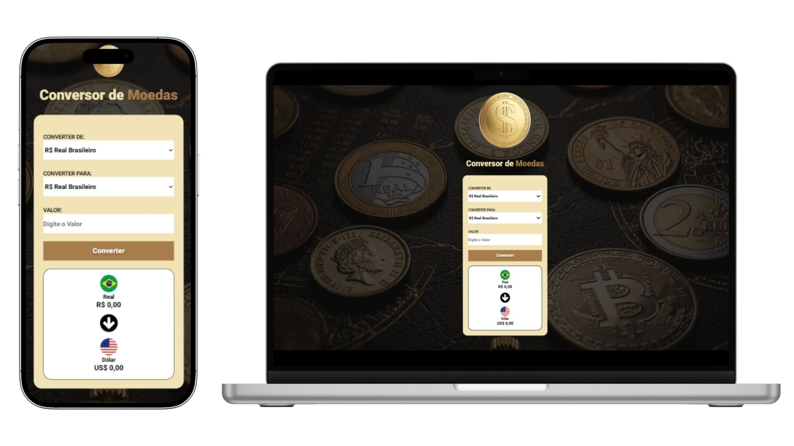

# 💱 Conversor de Moedas

Uma aplicação web desenvolvida para realizar conversões de moedas de forma rápida, simples e intuitiva.

O usuário pode informar um valor, selecionar a moeda de origem e a moeda de destino para obter o valor convertido diretamente na interface.

A aplicação conta com uma interface moderna e responsiva, proporcionando uma boa experiência tanto em dispositivos desktop quanto mobile.

---

## 🚀 Tecnologias utilizadas

<div>
  
  
  
</div>



### HTML5

Utilizado para estruturar a interface, campos de entrada, seletores de moedas e elementos responsáveis pela apresentação dos resultados.

### CSS3

Responsável pela criação do layout, estilização dos componentes e organização visual da aplicação.

### JavaScript

Utilizado para desenvolver toda a lógica de conversão, capturar os valores informados pelo usuário, realizar os cálculos e atualizar os resultados dinamicamente na página.

---

## 💰 Moedas disponíveis

A aplicação permite realizar conversões utilizando diferentes moedas:

```text
Código	Moeda
🇧🇷 BRL	Real Brasileiro
🇺🇸 USD	Dólar Americano
🇪🇺 EUR	Euro
🇬🇧 GBP	Libra Esterlina
🇯🇵 JPY	  Iene Japonês
🇨🇦 CAD	Dólar Canadense
🇦🇺 AUD	Dólar Australiano
🇨🇭 CHF	Franco Suíço
🇦🇷 ARS	Peso Argentino
🇨🇱 CLP	Peso Chileno
```

A disponibilidade das moedas pode variar de acordo com as cotações e configurações utilizadas na aplicação.

---

## ✨ Funcionalidades

* 💱 Conversão entre diferentes moedas
* 💰 Entrada de valores pelo usuário
* 🔄 Seleção da moeda de origem e destino
* 🧮 Cálculo automático da conversão
* 📊 Exibição do resultado diretamente na interface
* 📱 Interface responsiva
* ⚡ Atualização dinâmica utilizando JavaScript

---

## 🔄 Como funciona

```text
  💰 Valor informado
            ↓
  💵 Moeda de origem
            ↓
  💱 Moeda de destino
            ↓
  ⚙️ Processamento
            ↓
  🧮 Conversão do valor
            ↓
  📊 Resultado final
```

---

## 📱 Responsividade

A interface foi desenvolvida para proporcionar uma experiência consistente em diferentes tamanhos de tela.

O layout se adapta a computadores, tablets e smartphones, mantendo os elementos organizados e fáceis de utilizar.

---

## 🛠️ Estrutura do projeto

```text
Conversor-de-Moedas/
│
├── 📄 index.html
├── 🎨 styles.css
├── ⚙️ scripts.js
└── 🖼️ assets/
```

---

## 👨‍💻 Desenvolvedor

Desenvolvido por Andrei Kehl.
